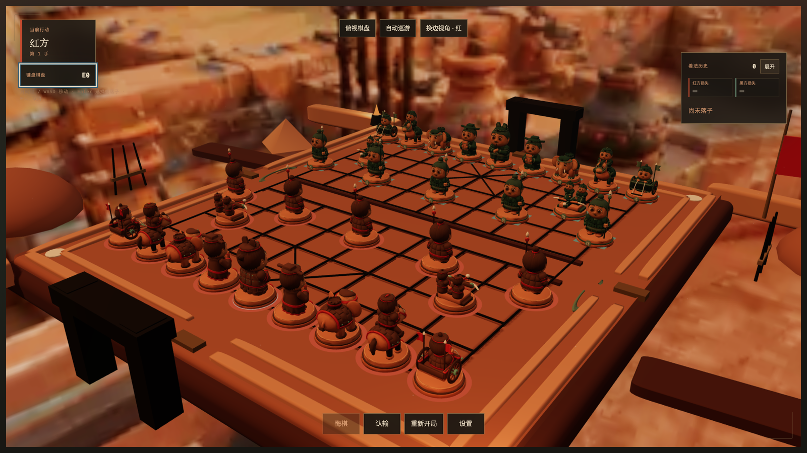

# 网页 3D 中国象棋

[](https://github.com/renyijiu/chinese-chess/actions/workflows/ci.yml)
[](https://github.com/renyijiu/chinese-chess/actions/workflows/codeql.yml)
[](LICENSE)

<p align="center">
  
</p>

在浏览器里下的 3D 中国象棋：32 枚棋子是 Q 版秦兵马俑，棋盘是一座陶土微缩沙盘。打开网页就能玩，不用安装，也不用登录。

> [!IMPORTANT]
> 项目处于实验性预发布阶段。规则、存档、桌面浏览器对局和生产构建已有自动化验证；手机真机的帧率、功耗和显存占用还没有实测。详见 [`docs/validation.md`](docs/validation.md)。

## 功能

- **本机双人**：两人在同一台设备上轮流走棋，可以悔一步。
- **人机对战**：简单、标准、困难、大师四档难度，全部在浏览器里计算，不需要服务器。
- **好友直连**（可选，默认关闭）：两台浏览器通过 WebRTC 直接对局，不需要游戏服务器。
- **3D 沙盘**：棋盘按九道纵线、十道横线、两座九宫和楚河汉界用代码生成；可切换战场视角与俯视、自动巡游，也可拖动旋转、滚轮缩放、右键平移。
- **画质可调**：高 / 中 / 低三档，另有“减少动态效果”开关。
- **自动存档**：棋局和设置保存在浏览器本地，刷新后接着下。
- **键盘可玩**：方向键或 WASD 移动，Enter 选子或落子，Esc 取消。

## 快速开始

需要 Git LFS、Node.js `>=22.13.0` 和 npm。

```bash
git lfs install
git clone https://github.com/renyijiu/chinese-chess.git
cd chinese-chess
git lfs pull
npm ci
npm run dev
```

然后打开 <http://localhost:3000>。

Blender 源文件、音频母带和大师难度的引擎权重存放在 Git LFS 里；没有执行 `git lfs pull` 时，构建前的校验会失败。只是运行游戏的话，不需要 Blender，也不需要重新生成模型。

## 对局模式

### 本机双人

红黑双方在同一台设备上轮流走棋，可以悔一步。

### 人机对战

| 难度               | 说明                                                                              |
| ------------------ | --------------------------------------------------------------------------------- |
| 简单 / 标准 / 困难 | 轻量搜索，在 Web Worker 里运行，不卡界面                                          |
| 大师               | 浏览器内运行的 Fairy-Stockfish NNUE（WebAssembly），第一次选择时下载约 `12.4 MiB` |

- 开局掷一枚六面骰：奇数执红，偶数执黑。结果随棋局一起保存，刷新不会重掷。
- 人机对局不能悔棋。
- 浏览器不满足大师难度的要求，或引擎加载失败时，本局自动改用困难难度并给出提示，之后也不会悄悄换回大师。
- 页面切到后台时，电脑暂停思考。

### 好友直连（可选）

实验功能，默认关闭。部署时设置下面的环境变量，开始菜单才会出现入口：

```bash
NEXT_PUBLIC_XIANGQI_ONLINE_ENABLED=1
# 可选：用逗号分隔的 STUN 服务器
NEXT_PUBLIC_XIANGQI_STUN_URLS=stun:stun.example.com:3478,stun:stun-backup.example.com:3478
```

连接分三步：房主创建邀请，把邀请文本发给好友；好友粘贴后生成回复文本，发回给房主；房主粘贴回复。连上后双方点“我已准备”开局。首局房主执红，再来一局时交换红黑。

使用前需要知道：

- 不提供 TURN 中继。公司网络、对称 NAT 或限制 UDP 的网络可能连不上，也不会改由服务器转发。
- 刷新页面会断开连接，需要重新交换邀请和回复；本地存档只用来在重新连接后核对并恢复棋局。
- 邀请和回复文本里有临时网络信息，只发给对局的好友，用完就删。
- 这是朋友之间的休闲对局：不能悔棋，不防作弊，也没有匹配、观战和账号。

完整流程、协议和排障见 [`docs/online-friend-match.md`](docs/online-friend-match.md)。

## 浏览器支持

- **桌面**：新版 Chromium、Firefox 和 Safari，需要 WebGL2。
- **手机**：新版 Chromium / Safari 可以触控操作，但真机性能还没有充分验证。
- **大师难度**另外需要 HTTPS、跨源隔离（响应头 `COOP: same-origin` 和 `COEP: require-corp`）、SharedArrayBuffer、WebAssembly SIMD 和 CacheStorage。不满足时自动改用困难难度。

## 技术栈

- React 19 + TypeScript + Vinext/Vite：页面与应用层。
- Three.js + React Three Fiber + Drei：3D 场景、模型加载、镜头和交互，基于 WebGL2。
- 象棋规则是独立的纯 TypeScript 模块（`lib/xiangqi/`），不依赖 React 和 Three.js。棋局只以规则模块的状态为准，动画、音效或 AI 出错都不会改动棋局。
- 部署在 Cloudflare Worker 上。人机对局和好友对局都不需要应用后端。

## 开发与测试

| 命令                                                            | 作用                                                        |
| --------------------------------------------------------------- | ----------------------------------------------------------- |
| `npm run dev`                                                   | 启动开发服务器                                              |
| `npm run build`                                                 | 生产构建（会先校验引擎资产和仓库元数据）                    |
| `npm run format:check` · `npm run typecheck` · `npm run lint`   | 格式、类型和代码规范检查                                    |
| `npm run test:unit` · `npm run test:runtime`                    | 规则、对局、联机、AI、表现层和运行时的单元测试              |
| `npm test`                                                      | 生产构建，并检查服务端输出的 HTML 和响应头                  |
| `npm run test:budget` · `npm run test:bundle`                   | 资产体积和 JavaScript 体积预算（`test:bundle` 需要先构建）  |
| `npm run test:e2e`                                              | 在开发服务器上跑浏览器端到端测试（含故障注入）              |
| `npm run test:e2e:release`                                      | 先构建，再对生产 Worker 跑对局和大师引擎测试                |
| `npm run test:online:e2e`                                       | 用两个隔离的浏览器跑完整的好友直连流程                      |
| `npm run test:visual`                                           | 桌面和手机截图对比                                          |
| `npm run test:performance` · `npm run test:performance:headed`  | 帧间隔、绘制调用和下载体积（`headed` 使用可见浏览器和 GPU） |
| `npm run assets:pieces:validate` · `npm run assets:ai:validate` | 校验角色模型和大师引擎文件                                  |
| `npm run assets:ai:canary`                                      | 在 Chromium 里实际加载大师引擎并走出一步合法着法            |

提交前至少运行格式、类型、代码规范检查和与改动相关的测试。要测试已部署的地址，设置 `PLAYWRIGHT_BASE_URL` 和 `PLAYWRIGHT_SKIP_WEB_SERVER=1`。每项测试覆盖什么、最近的实测结果和已知限制见 [`docs/validation.md`](docs/validation.md)。

## 文档

| 文档                                                                      | 内容                                     |
| ------------------------------------------------------------------------- | ---------------------------------------- |
| [`docs/architecture.md`](docs/architecture.md)                            | 代码结构和各模块的边界                   |
| [`docs/scene-and-assets.md`](docs/scene-and-assets.md)                    | 棋盘场景、画质档位、角色资产和性能预算   |
| [`docs/qin-diorama-art-direction.md`](docs/qin-diorama-art-direction.md)  | 美术风格约定                             |
| [`docs/online-friend-match.md`](docs/online-friend-match.md)              | 好友直连的流程、协议和限制               |
| [`docs/deployment.md`](docs/deployment.md)                                | 构建、Cloudflare Worker 响应头和上线检查 |
| [`docs/validation.md`](docs/validation.md)                                | 测试范围、实测数据和已知限制             |
| [`docs/releasing.md`](docs/releasing.md) · [`CHANGELOG.md`](CHANGELOG.md) | 发布流程和变更记录                       |
| [`THIRD_PARTY_NOTICES.md`](THIRD_PARTY_NOTICES.md)                        | 第三方代码、引擎和权重的来源与许可证     |
| [`ASSET_ATTRIBUTION.md`](ASSET_ATTRIBUTION.md)                            | 资产来源和提交资产的要求                 |

## 参与项目

- 报告缺陷：使用 GitHub 的 Bug 表单，并写清复现步骤。
- 提交代码或资产：先读 [贡献指南](CONTRIBUTING.md)。
- 报告安全漏洞：按 [安全策略](SECURITY.md) 私下报告，不要公开提 Issue。
- 使用问题：见 [支持说明](SUPPORT.md)。

## 许可证

本项目采用 [`GPL-3.0-only`](LICENSE)。
